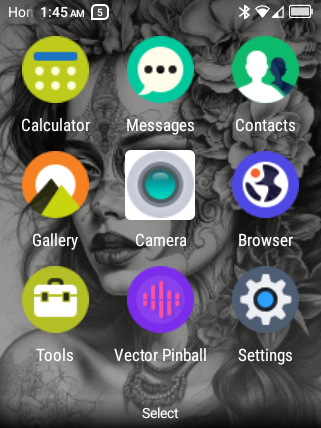
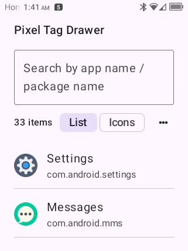
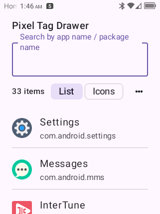

# Flip2 toolkit (TCL Gflip6 / Flip 2)

Turn a **TCL Flip 2** into a pocket-sized dumbphone powerhouse: T9 + offline voice dictation on the real keypad, a virtual mouse driven by the directional keys, a tag app drawer, a clean custom launcher, and a hardened Telegram client — installed **one zip, one boot**, or baked straight into your own firmware, with a **de-root path that actually works**.

<p align="center">
   
   
   
  
</p>

*Homescreen · customizable menu grid · TagDrawer app launcher · null-keyboard IME (no keyboard covering your screen)*

Modular, pipeline-driven tooling for **built-in menu grid (slots 1–9)**, **Launcher3 RRO overlay**, and **recovery** after bad Magisk launcher experiments.

**Quick start**

```bash
export PATH="$HOME/.local/share/flip2/bin:$PATH"
flip2 apply                    # push menu slots from slots.json
flip2 slot 5 com.android.music
flip2 editor                   # http://127.0.0.1:8765
```

Requires: USB debugging, **root** (overlay idmap), JDK + Android SDK build-tools, **apktool**.

## Architecture

| Area | Path | Role |
|------|------|------|
| CLI | `bin/flip2` | Single entry for all pipelines |
| Libraries | `lib/*.sh` | Paths, env, adb, constants |
| Overlay pipeline | `pipeline/overlay/` | `sync-slots` → build/install/enable |
| Recovery pipeline | `pipeline/recovery/` | Stock launcher + overlay after crash |
| RRO project | `launcher-overlay/` | `slots.json`, APK resources, Magisk pack |
| Launcher patch | `launcher-patch/` | **Withdrawn** whole-APK Magisk fix — see RECOVERY.md |
| Mouse pipeline | `pipeline/flipmouse/` | Vendored [FlipMouse](https://github.com/TylerBoni/FlipMouse) virtual mouse (Magisk) |
| Deploy pipeline | `pipeline/deploy/` | Four-tier packaging: image tree, installer zip, live setup, bundle |
| Image pipeline | `pipeline/image/` | System-tree assembly for base-image builds |

Full design: **[docs/PIPELINE.md](docs/PIPELINE.md)** · shared libs: **[docs/MODULES.md](docs/MODULES.md)**

## Deployment tiers

All tiers are driven by **`pipeline/deploy/manifest.json`** — the single source of truth for components, artifacts, root needs, and which tier includes what. Four ways to deploy the same set:

| Tier | Command | Output | Use |
|------|---------|--------|-----|
| **A** base image | `flip2 image build-tree` | `pipeline/deploy/dist/flip2-system-tree/` merged into *your own* stock firmware → fastbootd flash ([docs/IMAGE-BUILD.md](docs/IMAGE-BUILD.md)) | baked into the image, survives de-root |
| **B** installer zip | `flip2 installer pack [--flavor clean\|full]` | `flip2-installer-<flavor>-magisk.zip` — flash once via the Magisk app; self-removes after first boot | one-shot provisioning; `clean` installs only the root-independent set (de-root friendly) |
| **C** live setup | `flip2 setup full` | runs the existing per-component installs over adb, PASS/FAIL summary | the already-rooted device |
| **D** bundle | `flip2 pack-all` | `pipeline/deploy/dist/flip2-packages-<version>/` + `SHA256SUMS` | manual installs / release uploads |

De-rooting: the installer writes **`/data/local/flip2/deroot.sh`** at install time so it works even after root is gone; from a host, `flip2 deroot` pushes and runs it. What survives de-root: Launcher4, Null Keyboard, Forkgram, home-keys, default HOME/IME. What legitimately dies: FlipMouse, the keypad ⌫ remap, the nav-bar overlay, TagDrawer's system placement. The final step is always manual: Magisk app → Uninstall → Restore Images.

## Menu grid (MVP)

Edit **`launcher-overlay/slots.json`** (keys `1`–`9`, `@tools` for Tools folder). Then:

```bash
flip2 apply
```

Or one slot:

```bash
flip2 slot 7 org.chromium.chrome
```

**Homescreen** soft keys (Notifications / Menu / Shortcuts) are separate; use `home-keys.json` + `flip2 home-keys`.

## Do not use

- **`launcher-patch/dist/flip2_launcher3_icon_fix-magisk.zip`** — debug-signed Launcher3 replace caused homescreen crash loops. Use **`flip2 recovery`** if it was installed.

## Boot / fastboot (Linux)

- `autobooter-linux.py`, `mtk-bootseq.py`, `~/flip2-enter-fastboot.sh` — see [flip2 wiki](https://github.com/neutronscott/flip2/wiki).

## Legacy scripts

These delegate to the pipeline where noted:

| Script | Prefer |
|--------|--------|
| `launcher-overlay/scripts/apply-slots.sh` | `flip2 apply` |
| `launcher-overlay/scripts/edit-slot.sh` | `flip2 slot` |
| `launcher-patch/scripts/resolve-after-recovery.sh` | `flip2 recovery` |
| `~/flip2-launcher-editor.sh` | `flip2 editor` |
| `~/flip2-resolve.sh` | `flip2 recovery` |

## udev (adb on Linux)

```bash
sudo cp launcher-patch/scripts/51-android-flip2-adb.rules /etc/udev/rules.d/
sudo udevadm control --reload-rules && sudo udevadm trigger
```

Vendor **1bbb:0c01** (T & A Mobile).

## Virtual mouse (FlipMouse)

The `pipeline/flipmouse/` tree vendors [TylerBoni/FlipMouse](https://github.com/TylerBoni/FlipMouse) — a libevdev-based virtual mouse for keypad phones, built from source with the NDK and shipped as a Magisk module. The vendored copy is patched: it stays a **passive observer until activated** (upstream grabs the keypad at startup, which collides with the null-keyboard IME's `*` key), and mouse mode is toggled without touching `*`.

```bash
flip2 flipmouse build     # NDK armv7a build: static libevdev + mouse binary → Magisk zip
flip2 flipmouse install   # push + magisk --install-module, reboot needed
flip2 flipmouse status    # module dir, binary size, running process
flip2 flipmouse rollback  # remove module — reboot restores stock
```

## Null keyboard IME (T9 + dictation)

`pipeline/ime/null-keyboard` is a zero-height IME: the physical keypad goes through it and the screen stays free.

- `#` cycles text modes: **T9 predictive → ABC multi-tap → 123 digits**. Multi-tap is the classic non-predictive mode — press `2` once for a, twice for b, three times for c within 900 ms.
- Password and PIN fields choose the right mode automatically: text passwords start in ABC multi-tap with lower case (T9 is not offered there), numeric PINs start in 123.
- `*` cycles case while no word is being predicted; hold `*` for Vosk dictation; hold `#` for symbols.

```bash
flip2 ime build      # compile the APK
flip2 ime hide-bar   # install, set default, disable Kika, grant mic
flip2 ime restore    # back to the stock IME
```

## Forkgram patch (BACK deletes in text fields)

Telegram/Forkgram keeps hardware keys in the app (`ALT_FOCUSABLE_IM`), so the null-keyboard IME never receives BACK there and BACK closes the app. `pipeline/forkgram/` patches Forkgram's own `onBackPressed()` to delete in a focused, non-empty text field instead, and forces the IME to be shown. Physical and on-screen BACK both deliver `KEYCODE_BACK`, so both are covered.

```bash
flip2 forkgram patch              # pull installed APK, patch, sign, install
flip2 forkgram patch --no-install # build only
flip2 forkgram release            # install the hosted patched build (SHA-256 verified)
```

The patched APK is hosted in our Forkgram fork: [release `flip2-13.0.2.0-r1`](https://github.com/MRsmallAgain/TelegramAndroid/releases/tag/flip2-13.0.2.0-r1). The source-level change is proposed upstream as [Forkgram PR #539](https://github.com/Forkgram/TelegramAndroid/pull/539).

The original APK is backed up to `~/forkgram-original-13.0.2.0.apk`. The patched build is debug-signed, so switching from F-Droid requires one uninstall (`--uninstall`, wipes app data). See `pipeline/forkgram/README.md`.

## Credits

This toolkit stands on the work of:

- **[neutronscott/flip2](https://github.com/neutronscott/flip2)** — the foundation for everything here: device research, root method, fastboot/boot tools (`autobooter-linux.py`, `mtk-bootseq.py`), the original vMouse module our `vmouse` pipeline targets, and the wiki this whole modding approach depends on. Unlicense.
- **[TylerBoni/FlipMouse](https://github.com/TylerBoni/FlipMouse)** — the virtual mouse vendored into `pipeline/flipmouse/` (keypad→mouse via libevdev/uinput, Magisk module). Read Tyler's [dumbphone-journey write-up](https://dev.to/tylerboni/escaping-the-digital-treadmill-how-to-daily-drive-a-flip-phone-in-2025-tcl-flip-2-17el). README declares MIT (upstream repo has no standalone LICENSE file yet; credited and linked here rather than silently forked — local patches are ours).
- **[Vosk / alphacep](https://github.com/alphacep)** — offline speech recognition (Apache-2.0) powering the null-keyboard IME dictation; models from `flip2 ime models`.
- **[libevdev](https://www.freedesktop.org/wiki/Software/libevdev/)** — input-event handling in FlipMouse (built statically by its build script).
- **[Magisk](https://github.com/topjohnwu/Magisk)** — systemless modules used throughout.
- **TCL / MTK stock ROM** — the Flip 2 (Gflip6, 4058G) itself; RRO overlays and key-layout edits patch around, not over, the stock system.

If you reuse this repo, please carry those credits forward.
